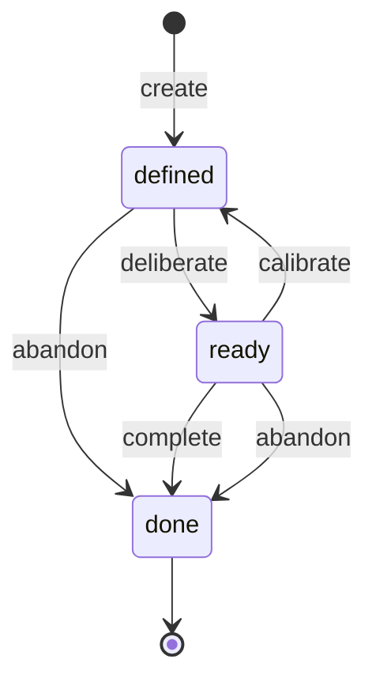

# Harness Model — GoalNode State Machine

The state machine models the lifecycle states of a single **GoalNode** — the core unit of the orchestration harness. The harness drives the goal tree by advancing nodes through these states. Acting itself is not a state: after a node is deliberated (`ready`), it is acted on, and the act's outcome moves it to `done`.

---

## 1. States

| State | Meaning | Focusable? |
|---|---|---|
| `defined` | node created with spec + premises; not yet deliberated | no |
| `ready` | deliberated (assessed + planned); act pending or in progress | **yes (leaf only)** |
| `done` | terminal — outcome recorded as `achieved` or `abandoned` | no |

Live: `defined, ready`. Terminal: `done` (outcome recorded as achieved/abandoned).

---

## 2. State Diagram (Mermaid)

---

## 3. Transition Table

| action \ state | defined | ready | done |
|---|---|---|---|
| `create` | defined | — | — |
| `deliberate` (assess + plan) | ready | — | — |
| `calibrate` (re-spec, back to defined) | — | defined | — |
| `abandon` (before deliberation) | done (abandoned) | — | — |
| `defer` / `re-plan` / `revise` | — | ready (unchanged) | — |
| `complete` (leaf success; internal = all children done) | — | done (achieved) | — |
| `abandon` | — | done (abandoned) | — |
| `reject` (parent declines challenge) | — | ready (unchanged) | — |

---

## 4. Rules

1. **Focus discipline.** `focus` is exactly one `ready` **leaf**. The base agent sees only that node's `spec` + `context`, never the whole tree. The act itself is not a state — a focused leaf is acted on, and the act's outcome moves it to `done` via `complete` or `abandon`.
2. **Decomposition happens during deliberation.** An internal node deliberates (`ready`), spawning one layer of children, each `defined` → `ready`. The parent rolls up to `done` only when all children settle.
3. **One level per cycle.** `decompose` spawns one layer of children; a child re-assesses on activation before decomposing further (P1 deferral).
4. **Terminal propagation.** Internal `done` with outcome `achieved` = all children `done` (achieved). An `abandoned` child forces the parent to re-evaluate — never silently roll up `done` over an abandoned child.
5. **Upward-only legitimacy (P2).** Challenges flow child → parent; only the parent may recalibrate a child (`calibrate`/`reject`/`abandon`). Root never challenges.
6. **Terminal is final.** Once `done`, a node never re-enters the live states.

---

## 5. Guarded Transitions (P2 / anti-oscillation)

The `abandon` / `calibrate` / `reject` outcomes of a child challenge are gated by parameters:

| Parameter | Meaning |
|---|---|
| `θ` | confidence threshold — a challenge fires only if `confidence ≥ θ` |
| `K` | per-node challenge cap; beyond it, challenges are downgraded to logs |
| `Δ` | cooldown — a node can't be recalibrated twice within `Δ` |
| `Dmax` | decomposition depth bound; `decompose` refused at `depth == Dmax` |

`θ, K, Δ, Dmax` are experiment parameters (tuned in pilot; referenced from `poc-stage1-design.md`).

---

## 6. Condition Mapping

Conditions are parameter sets over this single state machine:

| Cond | Decomposer | Challenger / Recalibrator | Behavior |
|---|---|---|---|
| A (flat) | one-shot list | off | tree degenerates to a list; re-prioritization = reorder `ready` |
| B (full pre) | eager to `Dmax` up front | off | fully expanded tree before execution |
| C (as-needed) | on, one level per activation | off | P1 only |
| D (as-needed + P2) | on | on | P1+P2 → **H1** |

---

## 7. Open Questions

- `revise`: mutate spec in place, or create a new node id (immutable history)? Affects trace/replay.
- May a `ready` internal parent abandon itself on a single strong child challenge, or must it roll up first? Affects oscillation.
- Does `attempt` returning `contradiction` skip `assess` and short-circuit directly to a challenge? (Current model: yes.)
